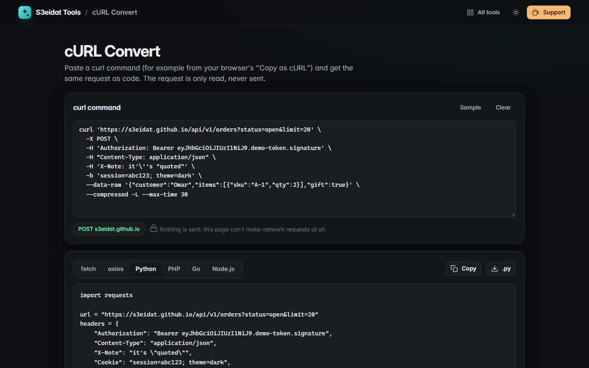

# cURL Convert

> Turn curl commands into JavaScript fetch, axios, Python requests, PHP cURL, Go net/http or Node.js code. Free, private, and it never sends the request.

### ▶ [Open cURL Convert](https://s3eidat.github.io/curl-convert/)



## Features

- Paste any curl command, including the output of your browser's **Copy as cURL (bash)**
- Real **shell quoting**: single quotes, double quotes with escapes, `'\''`, ANSI-C `$'…\n…'` strings, backslash line continuations, comments
- Understands `-X`, `-H`, `-d` / `--data` / `--data-raw` / `--data-binary` / `--data-urlencode`, `-F` (files and fields), `-u`, `-b`, `--json`, `-G`, `-I`, `-A`, `-e`, `--oauth2-bearer`, `--compressed`, `-k`, `-L`, `-m`, `--connect-timeout`, `-x`, `-T`, combined short flags (`-sSLk`) and `--opt=value`
- Fills in what curl adds by itself: the method implied by `-d`, the form Content-Type, `--json` headers, Basic auth
- Generates **fetch**, **axios**, **Python requests**, **PHP cURL**, **Go net/http** and **Node.js** (`node:https`) code; JSON bodies become real objects / dicts
- **What curl would send**: method, URL, query parameters, headers, body and form fields, with Authorization, Cookie and API-key values **masked** behind a reveal toggle
- Warnings for things that can't be converted (bodies read from files, cookie jars, URL globbing) and a list of options that were skipped
- Copy or download the code

Limits: only one request per command; redirect behaviour follows each library's default (noted where it differs from curl).
Values that curl would read from files become placeholders.

## Privacy

**The request is never sent.** The page only reads the text of the command, and it ships with a strict
Content-Security-Policy (`connect-src 'self'`), so the browser itself would block any attempt to contact the URL.
The command is not saved anywhere, because curl commands often contain tokens and cookies.

## Run it yourself

It's plain HTML, CSS and JavaScript with no build step:

```bash
git clone https://github.com/s3eidat/curl-convert
cd curl-convert
python -m http.server 8000
```

Then open http://localhost:8000.

## Support

If this saved you time, **[buy me a coffee ☕](https://s3eidat.github.io/coffee/)**. It keeps every tool free.

---

Part of **[S3eidat Tools](https://s3eidat.github.io/)**: 100+ free, private tools that run in your browser. MIT licensed.
